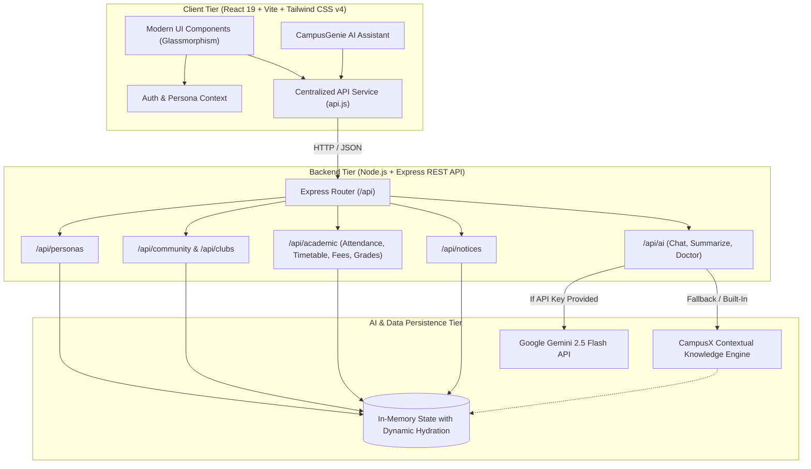

<div align="center">

# 🎓 CampusX
### The Next-Generation Unified Campus Operating System & Student Life Network

[](https://react.dev/)
[](https://vitejs.dev/)
[](https://tailwindcss.com/)
[](https://nodejs.org/)
[](https://expressjs.com/)
[](https://ai.google.dev/)
[](https://www.docker.com/)
[](https://opensource.org/licenses/MIT)

<p align="center">
  <b>CampusX</b> bridges the long-standing divide in collegiate higher education between fragmented student life communities and disconnected legacy ERP systems. Built with modern web architecture, responsive glassmorphic aesthetics, and context-aware artificial intelligence.
</p>

[Explore Features](#-core-platform-divisions) • [Architecture](#-system-architecture) • [Quickstart](#-quickstart--local-development) • [API Reference](#-rest-api-documentation) • [Deployment](#-cloud-deployment-guide)

---

</div>

## 📑 Table of Contents
- [Executive Overview](#-executive-overview)
- [Core Platform Divisions](#-core-platform-divisions)
  - [1. Student Life & Social Networking](#1-student-life--social-networking)
  - [2. Academic ERP & Institutional Operations](#2-academic-erp--institutional-operations)
  - [3. CampusGenie AI Copilot](#3-campusgenie-ai-copilot)
  - [4. Role-Based Multi-Persona Suite](#4-role-based-multi-persona-suite)
- [System Architecture](#-system-architecture)
- [Tech Stack](#-tech-stack)
- [Repository Structure](#-repository-structure)
- [Quickstart & Local Development](#-quickstart--local-development)
- [REST API Documentation](#-rest-api-documentation)
- [Cloud Deployment Guide](#-cloud-deployment-guide)
  - [Deploy to Render (Backend)](#render-deployment-backend)
  - [Deploy to Vercel (Frontend)](#vercel-deployment-frontend)
  - [Deploy with Docker](#docker-container-deployment)
- [Environment Variables](#-environment-variables)
- [License & Acknowledgments](#-license--acknowledgments)

---

## 📌 Executive Overview

Colleges and universities worldwide operate on two disjointed planes:
1. **Unregulated Peer Communication:** WhatsApp groups, Discord servers, and informal forums where academic notices and team searches get lost.
2. **Outdated ERP Portals:** Clunky 2000s portals that offer poor mobile experiences, lack transparency on attendance thresholds, and complicate fee settlements.

**CampusX** consolidates these workflows into a single high-performance web platform. Whether a student is calculating their safe lecture bunks before a national hackathon, reserving a 1-on-1 portfolio review with an alumni senior, clearing semester dues with instant digital receipts, or querying the AI Copilot on exam circulars — CampusX delivers a frictionless, centralized experience.

---

## 🚀 Core Platform Divisions

```
                                 ┌─────────────────────────┐
                                 │     CAMPUSX PLATFORM    │
                                 └────────────┬────────────┘
                 ┌────────────────────────────┼────────────────────────────┐
                 ▼                            ▼                            ▼
   ┌───────────────────────────┐┌───────────────────────────┐┌───────────────────────────┐
   │    STUDENT LIFE NETWORK   ││       ACADEMIC ERP        ││     CAMPUSGENIE AI        │
   ├───────────────────────────┤├───────────────────────────┤├───────────────────────────┤
   │ • Campus Buzz & Polls     ││ • Attendance & Cutoff Safe││ • Attendance Doctor       │
   │ • Societies & Hackathons  ││ • Real-time Timetable     ││ • Notice Summarizer       │
   │ • 1-Click Event RSVPs     ││ • SGPA & CGPA Transcript  ││ • Hackathon Ideator       │
   │ • 1-on-1 Mentor Guidance  ││ • Digital Fee Clearance   ││ • Resume Review (FAANG)   │
   │ • Peer Prep Circles       ││ • Departmental Circulars  ││ • Formal Leave Drafter    │
   └───────────────────────────┘└───────────────────────────┘└───────────────────────────┘
```

---

### 1. Student Life & Social Networking
* **Campus Buzz Community Forum:**
  * Categorized student discussions across `#Hackathons`, `#Academics`, `#Placements`, `#Lost & Found`, and `#Campus Life`.
  * **Interactive Polls Engine:** Instant voter recording with real-time percentage progression animations.
  * Real-time upvoting, tag filtering, global keyword search, and collapsible nested replies.
* **Societies & Campus Events Board:**
  * Interactive directories for official student chapters: *CodeX* (Algorithms & Dev), *RobotiX* (Hardware & IoT), *E-Cell* (Startups & Incubation), and *Kalakriti* (Arts & Culture).
  * Flagship event listings (*HackCampus 2026*, *Autonomous Drone Prototyping*, *E-Summit*, *Acoustic Night*).
  * **1-Click RSVP System:** Dynamically updates live attendee rosters and capacity limits.
  * Student event proposal portal to submit events for faculty and SAC approvals.
* **Senior-Junior Mentorship Hub:**
  * Curated directory of verified seniors placed at top tech firms (*Google, Amazon AWS, IISc Bangalore research scholars, and GSoC contributors*).
  * **1-on-1 Guidance Booking:** Book slots for resume critiques, DSA mock rounds, or graduate admissions.
  * Confirmed bookings panel featuring instant Google Meet conference links.
  * Peer study circles including the *LeetCode 75 Grind Group* and *GATE CSE 2027 Study Room*.

---

### 2. Academic ERP & Institutional Operations
* **Attendance & Exam Eligibility Doctor:**
  * Real-time course tracking (*Data Structures, Operating Systems, DBMS, Networks, AI/ML*).
  * Automatic statutory classification: `SAFE` (>80%), `WARNING` (75–80%), and `CRITICAL` (<75%).
  * **Safe Bunk Calculator:** Computes exact number of sessions a student can safely miss or must attend to satisfy the mandatory 75% university eligibility requirement.
  * **What-If Attendance Simulator:** Interactive slider modeling the impact of future attendances/skips.
  * Sticky-header, container-queried lecture history log adhering to modern web accessibility guidelines.
* **Dynamic Class Schedule & Timetable:**
  * Switch between daily timeline view and full weekly timetable matrix.
  * **"Happening Now" Indicator:** Highlights ongoing lecture periods with location room tags.
* **Grades, SGPA & CGPA Transcript:**
  * Cumulative Grade Point Average overview (8.84 / 10.0) with total degree credit progression (118 / 166).
  * Historical semester-by-semester SGPA performance progression.
  * Current semester mid-term marks, internal quiz evaluations, and projected grade allocations.
  * **Graduation Honors Planner:** Calculates the exact average SGPA required in remaining semesters to achieve target honors cutoffs (e.g., graduating with ≥ 9.0 CGPA).
* **Financial Accounts & Fee Clearance:**
  * Comprehensive fee breakdown: Total Annual Fee, Paid Balance, and Pending Dues (₹30,000).
  * **Digital Payment Gateway Simulator:** Integrated UPI, Debit/Credit Card, and Net Banking flows.
  * **Confetti Celebration:** Triggers dynamic physics-based confetti upon clearing dues.
  * Authenticated digital receipt generator complete with mock QR verification code and print formatting.
* **Official Circulars & University Bulletins:**
  * Departmental circulars filtered by urgency (`HIGH`, `MEDIUM`, `LOW`) and department authority.
  * Built-in full-text modal reader and digital PDF download simulator.

---

### 3. CampusGenie AI Copilot
Powered by **Google Gemini 2.5 Flash** with an integrated **Contextual Academic Reasoning Engine**:
* **Autonomous Academic Context Injection:** Injects live student records (attendance rates, subject deficits, upcoming exams, fee balances) into the prompt stream.
* **🩺 Attendance Doctor:** Prescribes mathematical recovery plans for borderline or critical subjects.
* **📋 1-Click Circular Summarizer:** Condenses lengthy administrative notices into *Core Objectives*, *Critical Deadlines*, and *Student Action Items*.
* **🚀 Hackathon Project Ideator:** Formulates end-to-end architectures, tech stacks, and pitch outlines tailored for tracks like Smart Agriculture, Edge AI, and FinTech.
* **🎯 Senior Mentor Resume Critique:** Analyzes project bullets using the Google XYZ formula (*"Accomplished [X] as measured by [Y] by doing [Z]"*).
* **✉️ Formal Administrative Drafter:** Drafts formal medical leave applications and recommendation requests addressed to departmental professors and deans.

---

### 4. Role-Based Multi-Persona Suite
Seamlessly switch roles via the top navigation bar to test permissions and operational views:
* 👨‍🎓 **Aarav Sharma (Student Persona):** 3rd Year B.Tech CSE • View attendance, calculate bunks, simulate payments, book mentors.
* 👨‍🏫 **Dr. Ramesh Gupta (Faculty / HOD Persona):** Head of Computer Science & Engineering • Access the **Faculty Admin Suite** to record lecture attendance and broadcast official circulars.
* 👩‍💻 **Priya Nair (Senior Mentor Persona):** 4th Year CSE / Google SDE Intern • Review student guidance requests and mentor booking slots.

---

## 🏛️ System Architecture



---

## 💻 Tech Stack

| Domain | Technology | Description |
|---|---|---|
| **Frontend Framework** | [React 19](https://react.dev/) | Component architecture with modern React Hooks |
| **Build Tooling** | [Vite 8](https://vitejs.dev/) | Next-generation frontend tooling with lightning HMR |
| **CSS & Design** | [Tailwind CSS v4](https://tailwindcss.com/) | Cutting-edge stylesheet engine with dark glassmorphism |
| **Icons & Aesthetics** | [Lucide React](https://lucide.dev/) | Consistent, clean iconography |
| **Visual Effects** | [Canvas Confetti](https://www.npmjs.com/package/canvas-confetti) | Physics-based celebratory particle engine |
| **Backend Runtime** | [Node.js v20+](https://nodejs.org/) | High-performance asynchronous JavaScript engine |
| **API Framework** | [Express 4](https://expressjs.com/) | RESTful API server with modular routing and CORS |
| **Artificial Intelligence** | [Google Gemini 2.5 Flash](https://ai.google.dev/) | Multimodal LLM via `@google/genai` with local fallback engine |
| **Containerization** | [Docker](https://www.docker.com/) | Multi-stage production container build |
| **Deployment Targets** | [Vercel](https://vercel.com/) / [Render](https://render.com/) | Decoupled and unified cloud edge deployment |

---

## 📂 Repository Structure

```
campusx/
├── .env.example               # Template for environment configuration
├── .gitignore                 # Standard exclusions for node_modules, build & secrets
├── Dockerfile                 # Multi-stage production container definition
├── docker-compose.yml         # Local container development configuration
├── Procfile                   # Cloud process execution configuration (Heroku/Railway)
├── render.yaml                # Render Blueprint infrastructure-as-code
├── vercel.json                # Vercel SPA routing and proxy definitions
├── package.json               # Monorepo orchestration scripts
├── README.md                  # Comprehensive architectural and operational guide
│
├── server/                    # Backend API Application
│   ├── package.json           # Server dependencies (Express, CORS, Morgan, @google/genai)
│   ├── index.js               # Primary Express server with static serving & REST routes
│   ├── data/
│   │   └── campusData.js      # Seed datasets for personas, courses, clubs, & notices
│   └── services/
│       └── aiService.js       # Gemini 2.5 Flash caller & contextual knowledge engine
│
└── client/                    # Frontend React Client
    ├── package.json           # Client dependencies (React 19, Tailwind, Lucide, Confetti)
    ├── vite.config.js         # Tailwind v4 plugin setup & local API reverse proxy
    ├── index.html             # Application entrypoint with typography optimizations
    └── src/
        ├── main.jsx           # React DOM root mounting
        ├── App.jsx            # Core layout, tab router, & Copilot integration
        ├── index.css          # Tailwind CSS layer rules & custom scrollbar styles
        ├── context/
        │   └── AuthContext.jsx # Global user persona state management
        ├── services/
        │   └── api.js         # Unified API client handling HTTP calls
        ├── components/
        │   ├── Navbar.jsx     # Navigation header with role switcher & search
        │   ├── Sidebar.jsx    # Dual-division navigation menu
        │   ├── Modal.jsx      # Accessible modal overlay with focus management
        │   └── CampusAICopilot.jsx # Floating AI Assistant with prompt suggestions
        └── pages/
            ├── Dashboard.jsx        # Unified high-level overview & live lectures
            ├── CommunityFeed.jsx    # Campus Buzz discussions, polls, and comments
            ├── ClubsEvents.jsx      # Societies showcase, hackathon listings & RSVPs
            ├── MentorshipHub.jsx    # Senior mentor directory, bookings & meet links
            ├── AttendancePortal.jsx # Cutoff indicator, bunk calculator & simulator
            ├── TimetableView.jsx    # Interactive daily & weekly timetable matrices
            ├── GradesTranscript.jsx # SGPA trends & honors target CGPA planner
            ├── FeePayments.jsx      # Digital fee clearance & printable receipt
            ├── NoticesBoard.jsx     # Departmental circulars & 1-click AI summarizer
            └── FacultyAdminPortal.jsx # Attendance recording & circular broadcasting
```

---

## ⚡ Quickstart & Local Development

### Prerequisites
* **Node.js** (v18.0.0 or higher)
* **npm** (v9.0.0 or higher)
* **Git** installed on your system

### 1. Clone & Install
```bash
# Clone the repository
git clone https://github.com/aryansachan630/CampusX.git

# Enter repository root
cd CampusX

# Install all dependencies across root, server, and client concurrently:
npm run install:all
```

### 2. Configure Environment (Optional)
Create a `.env` file in the root or `server/` directory:
```bash
cp .env.example .env
```
*(Optional: Add your `GEMINI_API_KEY`. If left blank, the built-in CampusX AI reasoning engine will seamlessly fulfill requests).*

### 3. Launch Development Environment
```bash
# Runs both backend (port 5000) and frontend (port 3000) concurrently:
npm run dev
```

* **Frontend Client:** [http://localhost:3000](http://localhost:3000)
* **Backend REST API:** [http://localhost:5000](http://localhost:5000)
* **API Health Check:** [http://localhost:5000/api/health](http://localhost:5000/api/health)

---

## 📡 REST API Documentation

### Personas & Authentication
| Method | Endpoint | Description |
|---|---|---|
| `GET` | `/api/personas` | Retrieve all mock personas (Student, Faculty, Mentor) |
| `GET` | `/api/personas/:id` | Retrieve specific persona details |

### Campus Buzz & Community
| Method | Endpoint | Description |
|---|---|---|
| `GET` | `/api/community/posts` | Fetch posts with optional `?tag=` and `?search=` queries |
| `POST` | `/api/community/posts` | Create new post (supports attached polls) |
| `POST` | `/api/community/posts/:id/like` | Toggle upvote/like for a user |
| `POST` | `/api/community/posts/:id/comments` | Post a comment to a discussion thread |
| `POST` | `/api/community/posts/:id/poll-vote` | Cast vote on a specific poll option |

### Clubs & Events
| Method | Endpoint | Description |
|---|---|---|
| `GET` | `/api/clubs` | Retrieve all registered campus societies |
| `GET` | `/api/events` | Retrieve upcoming hackathons, workshops & fests |
| `POST` | `/api/events/:id/rsvp` | Toggle student RSVP status |
| `POST` | `/api/events` | Propose/host a new campus event |

### Senior Mentorship
| Method | Endpoint | Description |
|---|---|---|
| `GET` | `/api/mentors` | Retrieve senior mentor directory |
| `GET` | `/api/mentorship/bookings`| Retrieve active 1-on-1 scheduled sessions |
| `POST` | `/api/mentorship/book` | Book guidance session with meet link generation |

### Academic ERP (Attendance, Timetable, Grades, Fees)
| Method | Endpoint | Description |
|---|---|---|
| `GET` | `/api/academic/attendance` | Retrieve overall & course-by-course attendance |
| `POST` | `/api/academic/attendance/mark` | Record lecture attendance (Faculty privileged) |
| `GET` | `/api/academic/timetable` | Retrieve weekly schedule matrices |
| `GET` | `/api/academic/grades` | Retrieve SGPA history & current internal marks |
| `GET` | `/api/academic/fees` | Retrieve fee transactions & pending balances |
| `POST` | `/api/academic/fees/pay` | Clear pending fees and issue digital receipt |

### Campus Notices
| Method | Endpoint | Description |
|---|---|---|
| `GET` | `/api/notices` | Fetch circulars filtered by department/urgency |
| `POST` | `/api/notices` | Broadcast official notice (Faculty privileged) |

### CampusGenie AI Copilot
| Method | Endpoint | Description |
|---|---|---|
| `POST` | `/api/ai/chat` | Contextual conversational response |
| `POST` | `/api/ai/summarize-notice` | 3-bullet circular synthesis |
| `POST` | `/api/ai/attendance-plan` | Mathematical attendance recovery prescription |
| `POST` | `/api/ai/hackathon-ideas` | 3 winning project ideas with tech architectures |
| `POST` | `/api/ai/polish-post` | Tone and engagement enhancer for post drafts |

---

## ☁️ Cloud Deployment Guide

### Render Deployment (Backend)
1. Go to [dashboard.render.com](https://dashboard.render.com/) and click **New +** → **Web Service**.
2. Connect your GitHub repository `CampusX`.
3. Configure the service:
   * **Name:** `campusx-api`
   * **Root Directory:** `server`
   * **Build Command:** `npm install`
   * **Start Command:** `node index.js`
   * **Instance Type:** `Free`
4. Deploy the service to receive your live backend URL (e.g. `https://campusx-api.onrender.com`).

### Vercel Deployment (Frontend)
1. Go to [vercel.com/new](https://vercel.com/new) and import the `CampusX` repository.
2. Configure settings:
   * **Framework Preset:** `Vite`
   * **Root Directory:** Click Edit and select `client`
   * **Environment Variables:**
     * Name: `VITE_API_URL`
     * Value: `https://campusx-api.onrender.com/api` *(Your Render backend URL)*
3. Click **Deploy**. Vercel will build and serve the client globally on edge networks.

### Docker Container Deployment
The unified production Docker image bundles both the React production build and the Express server into a single container:
```bash
# Build multi-stage production image:
docker build -t campusx:latest .

# Run container on port 5000:
docker run -d -p 5000:5000 --name campusx-app campusx:latest

# Or launch with docker compose:
docker compose up -d --build
```
Access the unified production platform at `http://localhost:5000`.

---

## 🔐 Environment Variables

| Variable | Scope | Default | Description |
|---|---|---|---|
| `PORT` | Server | `5000` | Port on which the Express server listens |
| `NODE_ENV` | Server | `development` | Set to `production` in live environments |
| `GEMINI_API_KEY` | Server / Client | `null` | Google Gemini API key for live LLM generation |
| `VITE_API_URL` | Client | `/api` | Base URL routing frontend API requests |

---

## 📄 License & Acknowledgments

Distributed under the **MIT License**. See [LICENSE](LICENSE) for full details.

### Acknowledgments
* Designed and built as a modern full-stack campus operating system.
* Inspired by the educational vision of **CampusX** and the collaborative open-source community.

<div align="center">
  <sub>Built with ❤️ by Aryan Sachan • Powered by React 19, Express, and Google Gemini AI</sub>
</div>
